# ProxyProof

**Classroom attendance that only counts when you're actually in the room.**

ProxyProof is an Android app for taking attendance with a QR code that changes every 15 seconds. A student can
only mark themselves present from their own phone, after unlocking it with their fingerprint or screen lock,
while standing within a few metres of the teacher. Every one of those checks is repeated on the server, so a
modified app can't skip them.

Built in Java and XML with Firebase Authentication and Cloud Firestore, as a B.Tech Mobile Application
Development mini project.

<p align="center">
  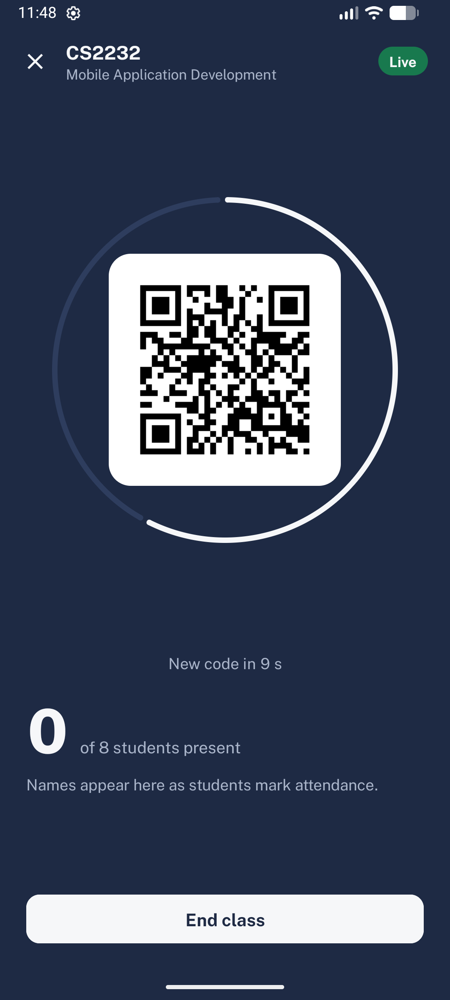
  &nbsp;
  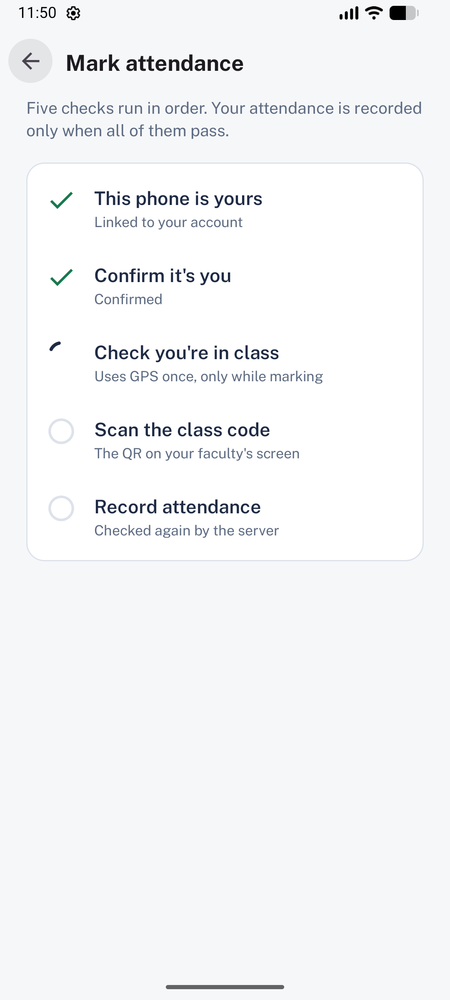
  &nbsp;
  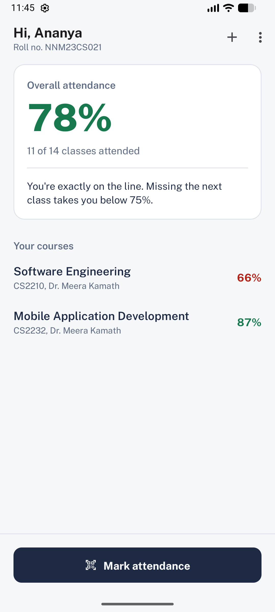
</p>

## Why

Paper roll calls and static QR codes are easy to cheat. A friend answers for you, a photo of the QR goes round
the class group chat, or one student marks three classmates from their own phone. ProxyProof stacks independent
checks so that each of those shortcuts fails:

| Proxy trick | What stops it |
|---|---|
| Forwarding a photo of the QR | The code rotates every 15 s and expires seconds after it leaves the screen |
| Reading the code from the database | The live code sits in a document only the teacher can read |
| Logging in to a friend's account | Each student account is locked to one phone when they sign up |
| Two accounts on one phone | Each phone can belong to only one student |
| Handing over an unlocked phone | Fingerprint or screen-lock check right before scanning |
| Marking from the hostel | GPS must be within 25, 50 or 100 m of the teacher; the server recomputes the distance itself |
| Fake GPS apps | Mock locations are rejected |
| Marking twice or editing later | One record per student per class; records can't be changed or deleted |
| Changing the phone's clock | Every timestamp comes from the server |
| A student signing up as faculty | Faculty sign-up needs an access code that no app can read |

No attendance app is perfectly proxy-proof. A rooted phone with a tampered app could still fake its GPS and phone
id, but the student would also need someone in the room streaming the live QR to them within seconds. The aim is
to make cheating harder than just turning up.

## Features

**Students**
- Sign up once; the account is linked to that phone
- Join a course with the teacher's 6-character code
- Mark attendance through a five-step checklist that tells you exactly which check failed and why
- See overall and per-course percentages, with a 75% hint like "You can miss 1 more class"
- Class-by-class history with the time and distance of each mark

**Faculty**
- Create courses and share a join code
- Start a class with a 25, 50 or 100 m radius and show a full-screen rotating QR
- Watch the present count and names update live
- Per-class report with present and absent lists
- Per-student percentages and a CSV register export
- Reset a student's phone when they change or lose it

Light and dark mode throughout.

## Screenshots

| Sign in | Faculty home | Course and students |
|---|---|---|
| 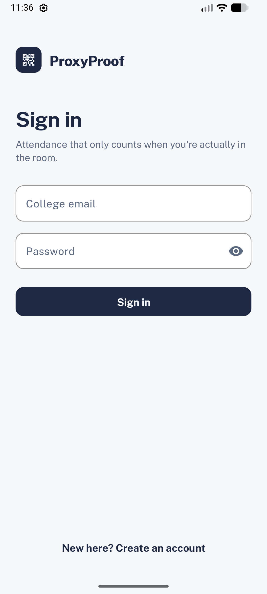 | 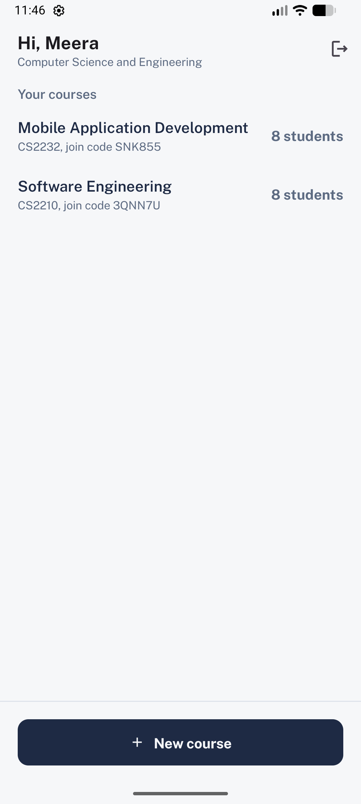 | 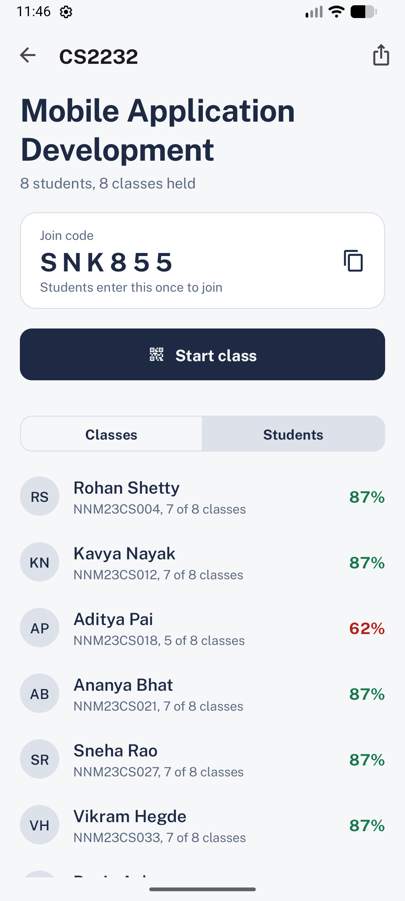 |
| **Live class** | **Class report** | **Proxy blocked** |
| 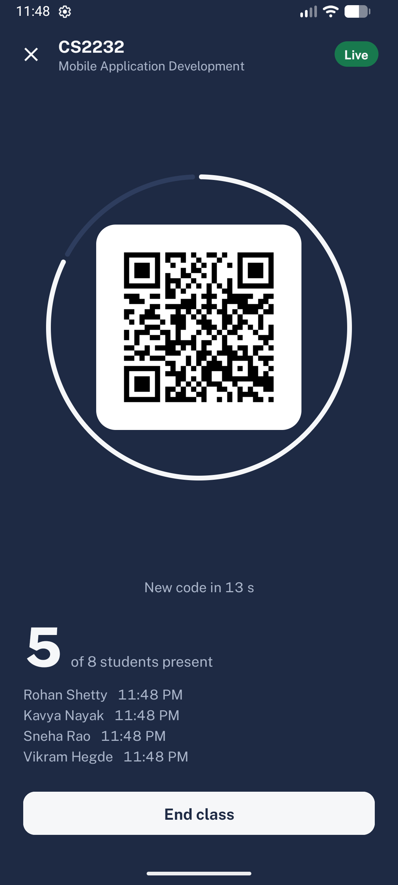 | 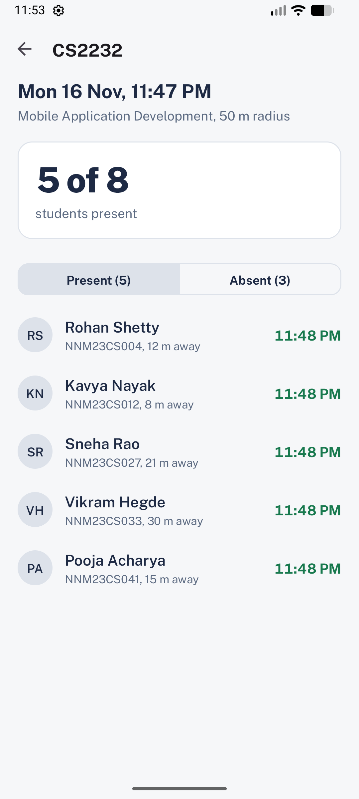 | 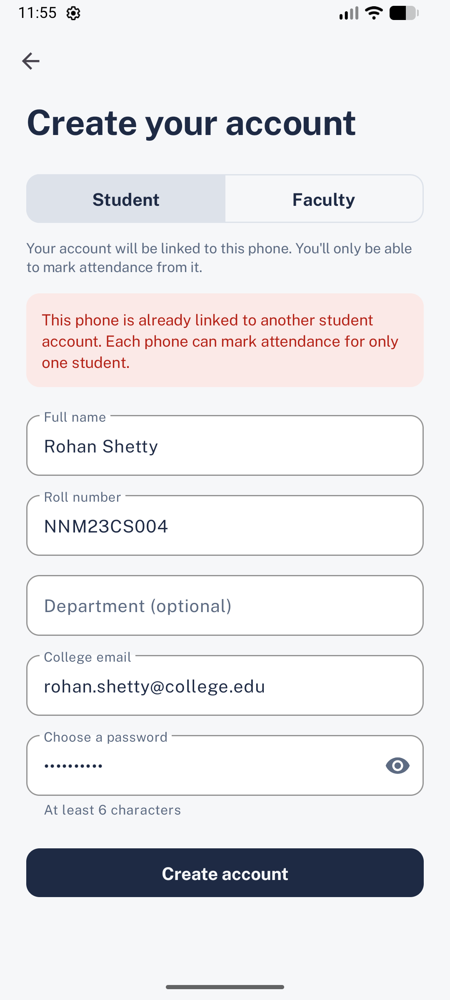 |
| **Course history** | **Below 75% warning** | **Register export** |
| 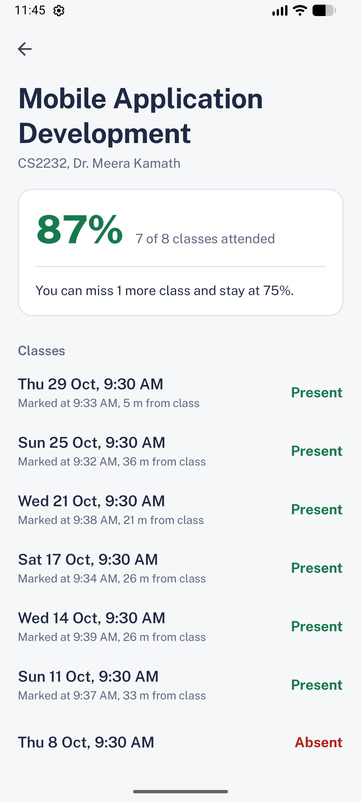 | 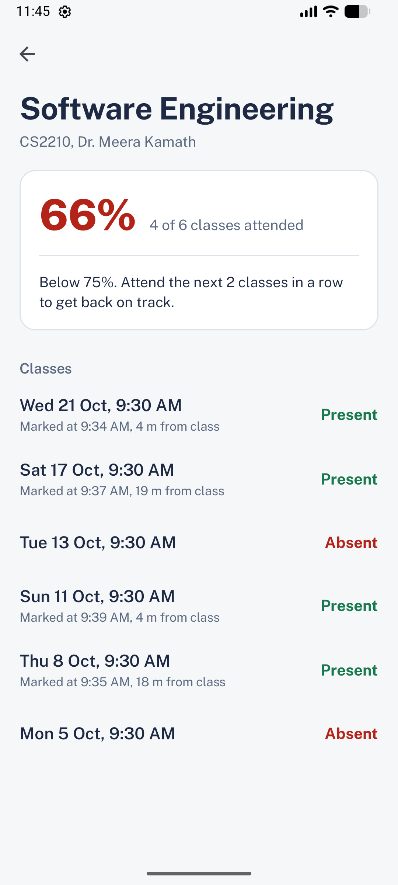 | 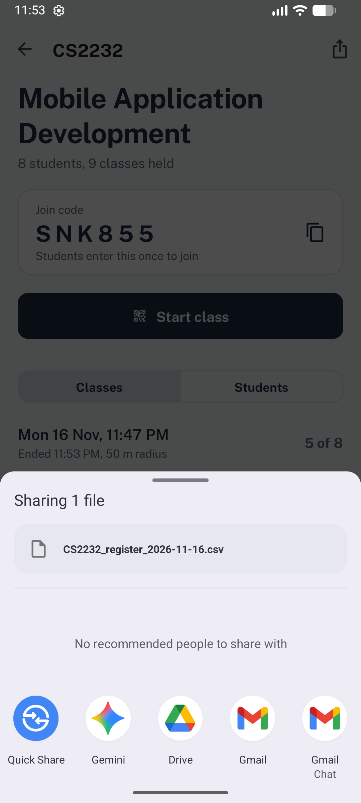 |

All screenshots are in [`report-screenshots/`](report-screenshots/). The names and data in them are made up.

## Getting started

You'll need Android Studio. The project targets Android 7.0 (API 24) and up.

### Option A: try it on the emulator, no Firebase account

The repo ships with a placeholder `app/google-services.json` (project `demo-proxyproof`). When the app sees a
`demo-` project, it talks to a local Firebase emulator instead of the cloud.

1. Install Node.js 18+ and make sure Java is on your PATH (Android Studio's bundled `jbr\bin` works).
2. Start the local backend and leave it running:
   ```
   cd rules-test
   npm install
   npx firebase emulators:start --only auth,firestore --project demo-proxyproof --config ../firebase.json
   ```
3. Open <http://localhost:4000> → Firestore → create a collection `config` with a document `faculty` and a string
   field `code`, for example `STAFF-2026`. Faculty enter this code when they sign up.
4. Open the project in Android Studio and run it on an emulator. Set a screen PIN on the emulator
   (`adb shell locksettings set-pin 1234`) and a location under *Extended controls → Location*.

The emulator camera can't scan QR codes, so use real phones to try the scan itself.

### Option B: real phones with your own Firebase project

1. In the [Firebase console](https://console.firebase.google.com), create a project and add an Android app with
   the package name `com.example.smartattendance`.
2. Download its `google-services.json` and replace `app/google-services.json` with it.
3. Enable **Authentication → Email/Password**.
4. Create a **Firestore** database in production mode, then paste [`firestore.rules`](firestore.rules) into the
   **Rules** tab and publish.
5. In Firestore data, add `config/faculty` with a string field `code` (your faculty access code).
6. Open the project in Android Studio, connect a phone with USB debugging on, and press **Run**.

The free Spark plan is enough. A step-by-step demo script and fixes for common problems are in
[`docs/DEMO.md`](docs/DEMO.md).

## Tests

```
gradlew testDebugUnitTest
```
Unit tests cover QR parsing (including tampered codes), code formats, percentages and the 75% maths.

```
cd rules-test
npm install
npx firebase emulators:exec --only firestore --project demo-proxyproof --config ../firebase.json "npm test"
```
31 attack scenarios run against the real Firestore rules engine: expired and guessed codes, marking for a friend,
outside the radius (including a tampered app claiming 0 m), double marking, editing records, reading the live code,
phone binding, faculty sign-up without the code, and privacy between students.

## Project layout

```
app/src/main/java/com/example/smartattendance/
  MainActivity.java        launch router and phone-binding check
  ProxyProofApp.java       switches to the local emulator for demo- projects
  auth/                    sign in and sign up
  student/                 home, course history, mark attendance
  faculty/                 courses, live class, class report
  data/                    Firestore models
  util/                    QR payload, codes, percentages, UI helpers
firestore.rules            server-side security rules
rules-test/                security rules test suite (Node)
docs/                      architecture notes and demo script
report-screenshots/        app screenshots
```

How a mark travels from the scan to the database, and the full data model, are in
[`docs/ARCHITECTURE.md`](docs/ARCHITECTURE.md).

## Limitations and ideas

- GPS and the phone id come from the phone itself. Firebase App Check with Play Integrity would close that gap, but
  it needs the paid Blaze plan.
- All faculty share one access code. A bigger rollout would have an admin approve each teacher.
- The fingerprint step proves the phone's owner unlocked it, not that the owner is the registered student. Face
  matching against a stored photo would go further.
- Classes held before a student joined a course count as absences, just like a paper register.
